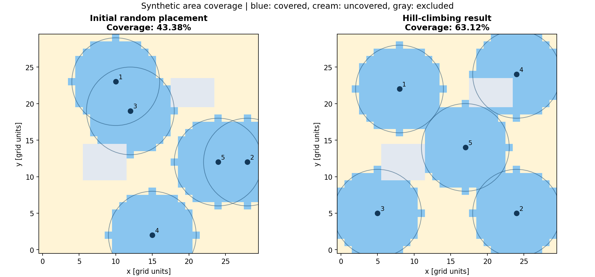
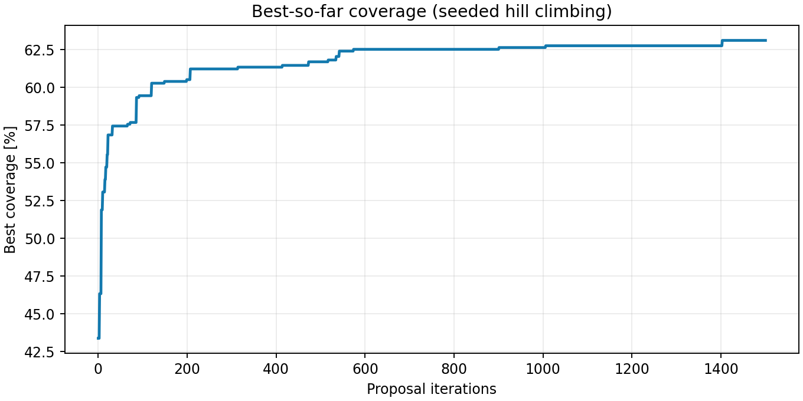

# Communication Node Placement Optimizer

A small educational Python prototype that improves the placement of communication nodes on a synthetic 2D grid using stochastic hill climbing.

**Scope:** a geometric area-coverage model, not a radio-network simulator. The optimizer is a classical search heuristic; no machine-learning model is trained. Developed with AI assistance as a learning prototype.



## Problem and assumptions

Where should a fixed number of nodes be placed to cover more target cells?

- Default terrain: 30 × 30 cells, with two rectangular excluded regions.
- Five nodes, each with a circular radius of six grid units.
- Node positions are integer cell centers `(x, y)`, must be distinct, and must lie in allowed cells.
- A target is covered when its center is within the radius of at least one node. Overlap counts once.
- Excluded cells are neither coverage targets nor valid placements. **They do not block signals.**
- Grid units are arbitrary; they are not calibrated meters or real radio ranges.

The objective is:

$$C = \frac{\text{number of covered allowed cells}}{\text{number of allowed cells}}$$

## Method

1. Generate a valid random starting layout.
2. Choose one node and propose a nearby move (75% probability) or a uniform jump to an allowed cell (25%).
3. Evaluate the union of circular coverage areas. Invalid proposals leave the candidate unchanged and still consume an evaluation.
4. Keep the candidate only when it strictly improves coverage.
5. Repeat for the requested iteration count.

The retained score never decreases, but the method can become trapped in local optima. It does not establish a global optimum. An equal-budget random-search baseline evaluates independent random layouts and retains its best layout, including the same starting layout. Each method uses 1,501 evaluations by default.

## Reproduce the example

Tested with Python 3.12.14 and the pinned dependencies in `requirements.txt`. Use 64-bit Python 3.11 or 3.12.

```bash
python -m pip install -r requirements.txt
python -m unittest -v
python main.py
python benchmark.py
```

Run these from this repository's root. Some systems use `python3` instead of `python`. Plots are saved to files; a desktop display is not required. For an isolated installation, create a virtual environment first (see `RUN_GUIDE_TR.md`).

Alternatively open `RUN_IN_COLAB.ipynb` in Google Colab and follow its upload instructions. The notebook uses this project's ZIP and runs the same Python source rather than maintaining a second implementation.

```bash
python main.py --grid-size 40 --nodes 6 --radius 7 --iterations 2000 --seed 7 --output-dir results/custom
python main.py --open-terrain --output-dir results/open_terrain
```

Using a separate output directory preserves the documented default example. `--grid-size` accepts 5–80, radius must be finite and positive, nodes cannot exceed allowed cells, and seed/iterations must be nonnegative.

## Recorded default result

| Metric | Value |
| --- | ---: |
| Allowed target cells | 846 |
| Initial covered cells | 367 |
| Improved covered cells | 534 |
| Initial coverage | 43.38% |
| Hill-climbing coverage | 63.12% |
| Improvement | 19.74 percentage points |
| Equal-budget random-search coverage | 58.16% |

Initial seed: 42; hill-climbing seed: 43; random-search seed: 44. The exact parameters and versions are recorded in `results/summary.json`.



`benchmark.py` repeats both searches for initial seeds 0, 1, 2, 3, and 42. Results are in `results/benchmark.csv`. Five illustrative seeds are not a statistical performance guarantee or evidence about real communication performance.

## Files

| File | Purpose |
| --- | --- |
| `main.py` | Model, hill climbing, baseline, CLI and figures |
| `benchmark.py` | Five-seed comparison with equal evaluation budgets |
| `test_main.py` | Hand-calculated coverage, constraints and reproducibility checks |
| `requirements.txt` | Pinned dependencies |
| `RUN_IN_COLAB.ipynb` | Browser-based run instructions and executable cells |
| `RUN_GUIDE_TR.md` | Turkish installation and execution guide |
| `PROJECT_NOTES_TR.md` | Turkish explanation of the model and results |
| `VALIDATION.md` | Validation record |
| `results/coverage_comparison.png` | Initial and improved placements |
| `results/convergence.png` and `.csv` | Best-so-far search progress |
| `results/node_positions.csv` | Initial and final coordinates |
| `results/summary.json` | Parameters, versions and metrics |
| `results/benchmark.csv` | Multi-seed baseline comparison |

## Validation and limitations

Tests check radius-one coverage by hand (five cells at the center, three at a corner), exclusion/overlap handling, invalid inputs, distinct allowed coordinates, seeded repeatability, nondecreasing scores and zero-iteration behavior. Tests validate this simplified implementation, not real-world RF behavior.

There is no terrain elevation, line-of-sight occlusion, signal attenuation, interference, noise, bandwidth, inter-node connectivity, energy consumption or equipment-specific calibration. Full geographic coverage does not imply a connected or usable radio network. Results depend on the grid, radius, initial layout, seed and evaluation budget.

## Possible extensions

Compare additional search heuristics; introduce weighted targets and connectivity constraints; then add independently validated propagation, elevation and line-of-sight models. These are future ideas, not implemented features.

## Development note

This project was prepared with AI-assisted code generation and documentation. It is presented as a starting educational prototype, not evidence of previous professional software-development experience or a completed research programme.
